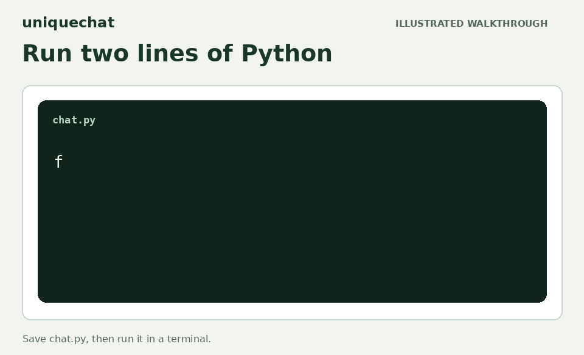

# uniquechat

[](https://colab.research.google.com/github/Unique50101/uniquechat/blob/main/UniqueChat.ipynb) [](https://mybinder.org/v2/gh/Unique50101/uniquechat/main?urlpath=lab%2Ftree%2FUniqueChat.ipynb) [](https://vscode.dev/github/Unique50101/uniquechat/blob/main/UniqueChat.ipynb)

## Run the notebook

Open the notebook and run all cells. Once the model loads, type into the black-and-white Unique chat panel. Send, retry the last reply, or clear the conversation. The first model download needs internet. The Jupyter badge launches Binder, a public hosted service. For local files, download [UniqueChat.ipynb](https://raw.githubusercontent.com/Unique50101/uniquechat/main/UniqueChat.ipynb) and open it in local JupyterLab. The VS Code badge opens the notebook editor. Select a Python kernel or open the notebook in desktop VS Code to execute it.

Install the notebook extra with `python -m pip install "uniquechat[notebook]"`. In a Python notebook, run:

```python
from uniquechat.notebook import launch_chat

panel = launch_chat()
```

The interface is provided by [Unique Interface](https://github.com/Unique50101/unique-interface). The original [cell-based example](https://github.com/Unique50101/uniquechat/blob/main/Quickstart.ipynb) is also available.

Choose a Hugging Face model in your browser, attach a file, and chat on your computer. **Once the package and model files are downloaded, the AI can work without internet.**



The animation illustrates the interaction with an example reply. An offline copy is included in `docs/quickstart.gif`.

## Run it

Use Python 3.10–3.13 in a virtual environment. From an extracted source checkout, install with `python -m pip install .`. For a downloaded wheel, use `python -m pip install uniquechat-0.1.0-py3-none-any.whl`. After publication on PyPI, the install command is `python -m pip install uniquechat`.

Save this as `chat.py` and run `python chat.py`:

```python
from uniquechat import launch
launch()
```

Select a model and click **Load model**. The first load needs internet for any missing files and can take several minutes. The chat opens when the model is ready. Type a question, or use the **+** button and then send your prompt. Choose **＋ New chat** to start again or switch models. Previous chats appear in the sidebar, saved with their attachments in this browser on this device. Stop the local server with Ctrl+C.

| Starter model | Inputs | Approximate weight download |
| --- | --- | --- |
| HuggingFaceTB/SmolLM2-135M-Instruct | Text and UTF-8 documents | 270 MB |
| HuggingFaceTB/SmolVLM-256M-Instruct | Text, UTF-8 documents and images | 510 MB |

Text files can be TXT, Markdown, CSV or JSON. Supported images are PNG, JPEG and WebP. Attach up to three files per message. Text files must fit the model's context window, even when smaller than the 32 KiB upload limit. Images are limited to 8 MiB and 16 megapixels each. Model weights, installed dependencies and runtime memory have separate space requirements.

## Run offline

Download a model by loading it once while online. On the same computer, using the same Hugging Face cache, run:

```python
from uniquechat import launch
launch(offline=True)
```

Choose your downloaded model. Offline mode loads model files from the cache and reports missing files. Chat generation runs on your CPU or available CUDA GPU. Prompts and attachments are processed on your computer. The browser connects to a loopback server. The first package installation and model download require internet unless their files have already been supplied locally.

## Skip the picker

```python
from uniquechat import launch
launch("HuggingFaceTB/SmolVLM-256M-Instruct")
```

From a terminal, use `uniquechat` or `uniquechat --offline HuggingFaceTB/SmolLM2-135M-Instruct`. You can enter other Transformers causal chat model IDs with built-in chat templates and safetensors weights. Image chat support targets Idefics3 and SmolVLM. Custom model code, GGUF files and image generation models are outside this version's scope.

## Maintainer release

Register a pending PyPI Trusted Publisher for project `uniquechat`, owner `Unique50101`, repository `uniquechat`, workflow `release.yml`, environment `pypi`. Push a version tag matching the package metadata, such as `v0.1.0`. The workflow builds the wheel and source archive, installs the wheel, generates a reply with both starter models using cached weights, uploads to PyPI, and attaches the distributions to a GitHub Release. Manual workflow runs verify the package without publishing.

## Run the GitHub Packages container

Run this command and open `http://127.0.0.1:7860` in Chrome. The named volume keeps downloaded models between runs.

```shell
docker run --rm -p 127.0.0.1:7860:7860 -v uniquechat-models:/cache ghcr.io/unique50101/uniquechat:0.1.0
```
